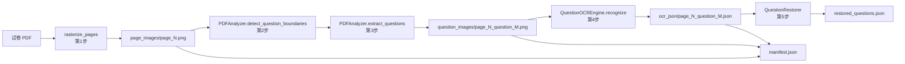

# 试卷 OCR 批量流程说明

对应 issue #5 的第 1-5 步。本文档说明流程边界、运行目录布局、归档 JSON 字段定义与验收口径。

## 1. 流程范围

| 步骤 | issue 描述 | 实现位置 |
| --- | --- | --- |
| 1 | 试卷 PDF 转换为图片 | `batch_process.rasterize_pages`（PyPDF2 取页数 + pdf2image 逐页渲染） |
| 2 | 边缘检测、分割题目边界 | 复用 `pdf_analyzer.PDFAnalyzer.detect_question_boundaries` |
| 3 | 分出各个题目图片，归档图片 | 复用 `pdf_analyzer.PDFAnalyzer.extract_questions`，传入运行目录 |
| 4 | OCR 识别并按 JSON 归档 | `batch_process.QuestionOCREngine` + 逐题 `ocr_json/*.json` |
| 5 | 组建还原模块，处理 JSON 数据 | `question_restorer.QuestionRestorer` |

第 6 步（通用 API 化）不在本流程范围内，按 issue 约定另立 issue。

调用关系：



## 2. 运行方式

```bash
python -m pip install -r ocr_module/requirements.txt

# 第 1-4 步：批量处理一份或多份试卷
python ocr_module/batch_process.py "ocr_module/target/2023年考研数学（一）真题.pdf" -o /tmp/exam_run --dpi 200

# 第 5 步：把逐题 OCR JSON 归一化成结构化题目记录
python ocr_module/question_restorer.py /tmp/exam_run
```

常用参数：

- `pdfs`：一个或多个试卷 PDF 路径，由操作者在运行时提供，不写死在代码里。
- `-o/--output-dir`：本次运行的输出目录，可以整体删除完成清理。
- `--dpi`：PDF 转图分辨率，默认 200。
- `--mode`：OCR 处理模式，`pix2text_only` / `paddleocr_only` / `combined`，默认 `combined`。
- `--clear`：运行前删除整个输出目录；不加该参数时只清理本流程管理的产物。

## 3. 运行目录布局

```text
<output-dir>/
├── manifest.json                    本次运行的归档索引
├── errors.json                      本次运行的错误汇总（逐条）
├── restored_questions.json          第 5 步输出的结构化题目记录
├── page_images/                     第 1 步输出，page_{N}.png
├── question_images/                 第 3 步输出，page_{N}_question_{M}.png
└── ocr_json/                        第 4 步输出，page_{N}_question_{M}.json
```

- 逐题图片沿用仓库已有的 `page_{N}_question_{M}.png` 命名。
- 一次传入多份试卷时，所有产物文件名加上 `doc{序号}_` 前缀，避免不同试卷的同页同名相互覆盖。
- 重复运行同一输入会覆盖同名文件，并删除上一轮残留的页面图片、题目图片、逐题 JSON 与三个汇总 JSON；用户自行放进该目录的其他文件不受影响。
- 运行产物（图片与 JSON）不提交进仓库，见第 7 节。

## 4. 归档 JSON 字段定义

所有 `*_path` 字段一律使用正斜杠 `/` 分隔符，不出现 `test_pdf_analysis_results.json` 里那种平台相关的 Windows 反斜杠。相对基准如下：

| 字段 | 基准目录 | 兜底写法 |
| --- | --- | --- |
| `run_dir` | 仓库根目录，其次当前工作目录 | 绝对路径的正斜杠写法 |
| `documents[].source_pdf_path`、`source.source_pdf_path` | 仓库根目录，其次当前工作目录（试卷通常放在仓库内，便于题源追溯） | 绝对路径的正斜杠写法 |
| 页面图片、题目图片、逐题 JSON 路径（含引擎返回里形如 `xxx_path` 的字段） | `run_dir` | 绝对路径的正斜杠写法 |
| `manifest_path` / `errors_path` / `restored_path` | 直接写相对 `run_dir` 的文件名 | — |


### 4.1 `manifest.json`

| 字段 | 含义 |
| --- | --- |
| `schema_version` | 归档结构版本，当前 `1.0` |
| `generated_at` | 本次运行的时间戳（ISO 8601，含时区） |
| `run_dir` | 运行目录路径，见上述基准规则 |
| `dpi` | 第 1 步使用的转图分辨率 |
| `engine` | OCR 处理模式名，即引擎名称（`combined` 等） |
| `placeholder_output` | 固定 `true`，见第 6 节 |
| `output_dirs` | 三类产物所在子目录名 |
| `manifest_path` / `errors_path` / `restored_path` | 三个汇总文件相对 `run_dir` 的文件名 |
| `total_documents` | 本次处理的试卷份数 |
| `total_pages` | 成功转图的页数 |
| `total_questions` | 成功裁剪并登记的题目数（识别失败的题也计入） |
| `total_errors` | 本次运行的错误条数 |
| `success` | `total_errors == 0` 时为 `true` |
| `documents[]` | 每份试卷的索引，见下 |

`documents[]` 每项：

| 字段 | 含义 |
| --- | --- |
| `source_pdf_path` | 该份试卷 PDF 的归档路径 |
| `total_pages` | PyPDF2 读到的页数 |
| `converted_pages` | 成功转图的页数 |
| `total_questions` | 该份试卷登记的题目数 |
| `pages[]` | 每页的索引 |

`pages[]` 每项：

| 字段 | 含义 |
| --- | --- |
| `page_number` | 页码，从 1 开始 |
| `page_image_path` | 页面图片相对 `run_dir` 的路径 |
| `question_count` | 该页成功登记的题目数 |
| `questions[]` | 逐题索引 |

`questions[]` 每项：

| 字段 | 含义 |
| --- | --- |
| `question_number` | 页内题号，从 1 开始 |
| `question_image_path` | 题目图片相对 `run_dir` 的路径 |
| `bounding_box` | 题目在原页内的位置 `[x, y, w, h]`，像素坐标 |
| `ocr_json_path` | 逐题 OCR JSON 相对 `run_dir` 的路径；识别或归档失败时为 `null` |

### 4.2 `ocr_json/page_{N}_question_{M}.json`

| 字段 | 含义 |
| --- | --- |
| `schema_version` | 归档结构版本 |
| `generated_at` | 生成时间戳 |
| `engine` | 产出该结果的引擎名称（处理模式） |
| `placeholder_output` | 固定 `true`，见第 6 节 |
| `note` | 占位值说明，避免被误认为真实识别结果 |
| `source.source_pdf_path` | 来源试卷的归档路径 |
| `source.question_image_path` | 题目图片相对 `run_dir` 的路径 |
| `source.page_number` / `source.question_number` | 来源页码与页内题号 |
| `source.bounding_box` | 页面坐标 `[x, y, w, h]` |
| `confidence` | 从引擎返回中取出的整体置信度；引擎未给出时为 `null` |
| `ocr` | 引擎返回内容的原样副本，不做任何改写；其中的 `*_path` 字段统一按第 4 节规则书写 |

`confidence` 的取值顺序：`confidence_score`（combined）→ `confidence` → `text_recognition.scores` 最大值（paddleocr_only）
→ `formula` / `text` 子结果的 `confidence` 最大值（pix2text_only）→ `null`。

占位引擎对所有题目返回同一组硬编码内容，因此逐题 JSON 与结构化记录的文本在各题之间相同，这是当前引擎的行为，不是流程 bug。

### 4.3 `errors.json`

```json
{ "errors": [ { "step": "ocr", "pdf": "...", "page": 2, "question": 1, "message": "..." } ] }
```

| 字段 | 含义 |
| --- | --- |
| `step` | 失败环节：`pdf_to_image` / `detect_boundaries` / `crop_question` / `ocr` / `write_archive` |
| `pdf` | 出错的试卷归档路径，未知时为空字符串 |
| `page` / `question` | 出错的页码与题号，不适用时为 `null` |
| `message` | 错误信息 |

### 4.4 `restored_questions.json`

| 字段 | 含义 |
| --- | --- |
| `schema_version` / `generated_at` | 同上 |
| `total_questions` | 成功还原的题目记录数 |
| `total_errors` | 还原过程中的错误条数 |
| `questions[]` | 结构化题目记录 |
| `errors[]` | 逐条还原错误，字段为 `step` / `pdf` / `ocr_json_path` / `message` |

`questions[]` 每项（口径来自 `doc/题库自动化处理系统实施方案.md` 的“结构化存储”）：

| 字段 | 含义 |
| --- | --- |
| `question_id` | 题目标识，取自逐题 JSON 文件名（去扩展名） |
| `source_pdf_path` | 来源试卷，题源追溯用 |
| `page_number` | 来源页码 |
| `question_number` | 页内题号 |
| `question_image_path` | 题目图片相对 `run_dir` 的路径 |
| `ocr_json_path` | 逐题 OCR JSON 相对 `run_dir` 的路径 |
| `engine` | 产出该记录的引擎名称 |
| `stem` | 题干文本，多行以换行拼接 |
| `options[]` | 选项列表，每项为 `{"label": "A", "text": "..."}` |
| `answer` | 答案文本，识别结果中没有“答案”行时为 `null` |
| `bounding_box` | 页面坐标 `[x, y, w, h]`，来自第 4 步归档 |
| `confidence` | 置信度，来自第 4 步归档 |

题干、选项、答案的拆分规则：优先使用引擎返回的逐行文本（`ocr.paddleocr_result.text_recognition.texts`），
退回 `ocr.combined_text` / `ocr.text.text` 按换行拆分。三类行的判定相互独立、与出现顺序无关：

- 答案行必须行首锚定，形如 `【答案】 X`（冒号可选）或 `答案：X` / `答案:X`（冒号必需）。
  题干里出现「答案」二字（如「下列答案为无穷小量的个数」「答案见解析」）不算答案行，仍留在 `stem` 中。
- 选项行匹配 `A.` / `B、` / `C)` 之类的行首标号，答案先出现也不会关掉选项分支。
- 其余行按顺序以换行拼成 `stem`。出现多行答案时取第一行。

## 5. 失败处理约定

- 单个环节失败不会中断整批：某页无法转图、某页未检测到题目、某张图片裁剪失败、某张识别报错、某个 JSON 写盘失败，
  都会作为一条记录写入 `errors.json`，其余页面与题目继续处理。
  - 第 1 步按页容错：渲染失败的页面单独记录一条 `pdf_to_image` 错误（带 `page`），其余页面继续走第 2-4 步；
    失败页面不会留下半张图片，`manifest` 的索引与磁盘产物保持一致。
  - 整页都失败时该试卷的 `pages` 为空，`total_pages` 仍记录 PDF 页数，失败原因逐页可见。
  - 只有整份试卷级别的失败（文件不存在、打不开、读不到页数）才跳过该试卷的后续步骤。
- 重复运行会清理上一轮的页面图片、题目图片、逐题 JSON 与两个汇总文件，只删本流程管理的文件名，
  并且不以上一轮是否写出 `manifest.json` 为前提，中途崩溃留下的残留产物同样会被清掉。
- 还原模块同样逐条记录：OCR JSON 无法读取或解析、缺少 `ocr` / `source` 字段、题目内容为空、
  索引里 `ocr_json_path` 为空，都记录错误并跳过该条，不写入 `questions[]`，也不抛未捕获异常。
- 退出码：
  - `python ocr_module/batch_process.py`：`0` 全部成功；`1` 存在失败项，stderr 逐条列出失败环节与位置；`2` 依赖缺失。
  - `python ocr_module/question_restorer.py`：`0` 全部成功；`1` 存在还原错误；`2` 运行目录里没有可读的归档。

## 6. 当前引擎返回占位值

master 上 `src/pix2text/processor.py` 与 `src/paddleocr/processor.py` 的 `_initialize_model` 只写日志，
`recognize_text` / `recognize_formula` / `recognize_table` 返回硬编码的示例内容。因此：

- 逐题归档 JSON 原样保存引擎返回内容、`confidence` 与 `engine` 名称，不做任何修饰，也不承诺识别文本正确。
- 归档与索引都带 `placeholder_output: true`，逐题 JSON 另有 `note` 字段说明这一点。
- 接入真实 Pix2Text / PaddleOCR 模型属于 issue #2 的范围，本流程只验收流水线与归档结构，
  不断言识别文本正确性，也不承诺 `doc/` 中的准确率与性能指标。

## 7. 依赖与门禁

- 本流程实际依赖 `pdf2image`、`PyPDF2`，已写入 `ocr_module/requirements.txt`。
  `pdf2image` 是 poppler 命令行的包装，还需要系统侧的 `poppler-utils`（提供 `pdftoppm`、`pdfinfo`）。
- 依赖缺失时 `batch_process.py` 在启动阶段给出点名包名/系统包的安装指引并以退出码 `2` 返回，代码中不在运行时执行 `pip install`。
- 默认轻量门禁不变，且不需要 poppler、OCR 模型或仓库内 PDF 的绝对路径：

```bash
python -m compileall -q ocr_module
python -m pytest -q ocr_module/latex_to_image/test_converter.py
python -m pytest -q ocr_module/test_batch_process.py
```

- 新增自检 `ocr_module/test_batch_process.py` 全部使用运行时生成的临时 fixture：
  第 1 步用一个临时多页 PDF 加 `pdf2image` 替身验证按页命名，第 2-4 步用本地生成的分页图片走真实的边界检测与裁剪代码，
  还原步骤直接读取归档 JSON。脚本类的手工验证（`test_pdf_analyzer.py` 里的 Windows 绝对路径）保持原样，不属于门禁。
